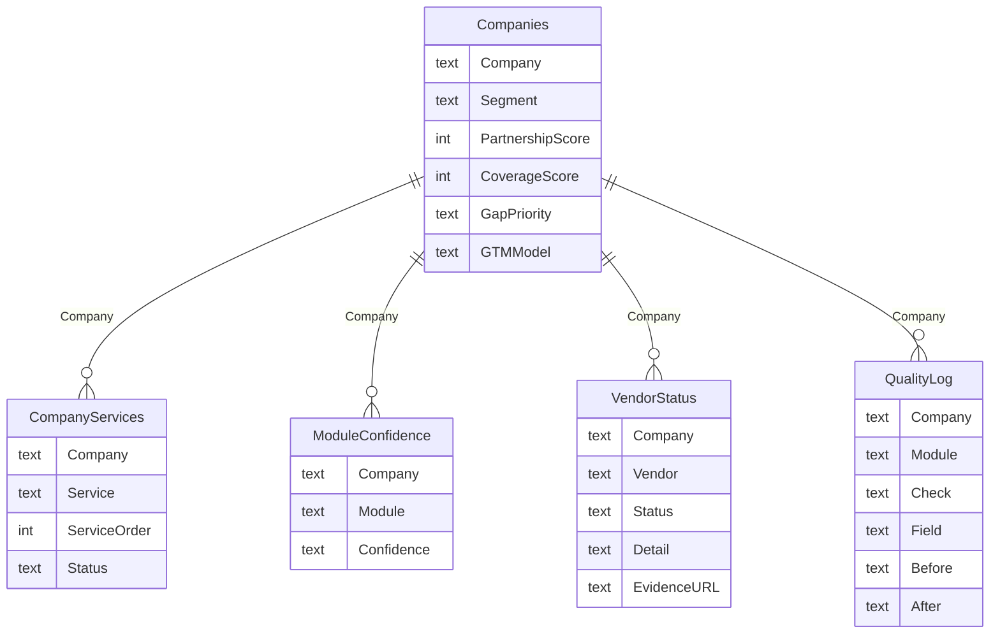

# Singapore Partner Intelligence

Research into **152 Singapore cybersecurity services firms**, assessed as potential channel partners for a managed
security provider (the client). It answers: *which partners fit best, which services they lack, which vendors they
already work with, and how they sell.*

Each firm was:
- segmented and given a **1–5 Partnership Potential Score**;
- checked against **9 core security services**, giving a coverage score and a gap priority;
- mapped to **6 security vendors and 2 SIEM platforms**;
- profiled for **funding** and **go-to-market model** (direct, partner-led or hybrid).

Every module rates its own findings High / Medium / Low and keeps evidence links. The services module ran two live
verification passes, and an audit corrected 13 scores and 16 segments.

This continues the [Singapore Provider Screening](https://github.com/ainunizhar/Singapore-Provider-Screening), where
**336 companies were screened and 153 kept** as genuine cybersecurity services providers; 152 of them are profiled
here. This repository holds the results as a **Power BI Project** (Power Query, a star-schema model, 35 DAX
measures, 7 report pages).

**Built with:** Power BI (Power Query M, DAX, PBIP / TMDL + PBIR), Python for data preparation.

---

## The research data

The research ran in modules. Each module wrote its own workbook, and the Power BI model joins them on company name.

| Module | What it records per partner | Confidence (High / Medium / Low) |
|---|---|---|
| **Segmentation** | segment, sub-segment, market focus, geographic reach, size tier, score 1–5, CSA licence, CREST certification, operating status | 116 / 35 / 1 |
| **Services gap** | 9 services (Yes / Partial / No / Unknown), coverage score 0–9, gap priority, upsell services, regulated-sector focus | 90 / 42 / 20 |
| **Tech vendors** | partner status with Palo Alto Networks, CrowdStrike, Microsoft Security, Fortinet, Trend Micro and Acronis; primary SIEM platform | 25 / 71 / 56 |
| **Funding** | ownership type, funding stage, disclosed funding, latest round, revenue estimate, growth signal, exit likelihood, government link | 27 / 105 / 20 |
| **Go-to-market** | Direct / Partner-led / Hybrid / Unknown, with an evidence quote and link; Singapore presence check | 33 / 87 / 32 |

Sources were company websites (services, partners, customers and about pages), vendor partner locators, press
releases, LinkedIn company pages, company registries and web search. Rows keep the links to their sources.

## Method and results per module

### Segmentation and the partnership score

Each partner gets one of 14 segment codes and a **Partnership Potential Score**:

| Score | Label | Rule (summary) | Partners |
|---|---|---|---|
| 5 | Tier 1 Strategic Partner | established MSSP / MDR with a Singapore SOC, 50+ staff or $10M+ revenue, finance / government / enterprise clients, ASEAN reach, no direct overlap with the client's own services | 16 |
| 4 | High Potential Partner | growing MSSP / MDR / SOC or specialist, 20–100 staff, Singapore HQ, strong growth signals | 34 |
| 3 | Medium Potential Partner | consultancy, GRC or IT firm with a cyber practice; local focus; could refer or co-sell | 65 |
| 2 | Low Priority / Monitor | boutique or micro firm | 30 |
| 1 | Not a Fit Currently | wrong segment, too small, product-only or wrong geography | 7 |

A **+1 bonus** (capped at 5) applies for any of these:
- regulated-sector clients or credentials (MAS, CSA, GovTech);
- CREST certification or a CSA licence for managed security;
- a high growth tier, or a high heat tier with 50+ staff;
- Series A funding or later;
- activity in 3+ ASEAN countries.

| Segment | Partners | Avg score | Score 4–5 | Score 5 |
|---|---|---|---|---|
| MSP with Security Practice | 36 | 2.75 | 4 | 0 |
| Systems Integrator | 23 | 2.78 | 4 | 0 |
| Penetration Testing | 20 | 3.75 | 12 | 5 |
| Managed Security Service Provider | 17 | 3.88 | 12 | 3 |
| Cybersecurity Consultancy | 17 | 2.35 | 1 | 0 |
| Governance, Risk & Compliance | 9 | 2.78 | 2 | 0 |
| Threat Intelligence | 7 | 3.43 | 3 | 2 |
| Cloud Security | 5 | 3.40 | 1 | 1 |
| Identity & Access Management | 4 | 4.25 | 3 | 2 |
| Managed Detection & Response | 4 | 4.25 | 4 | 1 |
| OT/ICS Security | 4 | 3.25 | 2 | 0 |
| Incident Response | 3 | 4.33 | 2 | 2 |
| Virtual CISO | 2 | 3.00 | 0 | 0 |
| Fraud Detection Services | 1 | 2.00 | 0 | 0 |

Credentials were checked one by one: **18** partners have a confirmed CSA licence and **14** a confirmed CREST
certification. Of the regulatory-credential flags, 58 were confirmed, 85 remain unverified and 9 were removed as
not substantiated.
**7** partners turned out to be acquired, dormant or closed.

### Services gap

Each of the 9 services is rated per partner:
- **Yes:** clearly delivered (core offering, a service page, or an accreditation);
- **Partial:** mentioned, resold or implied, but not a core offering;
- **No:** no evidence;
- **Unknown:** not enough information (for example, a dead website).

- **Coverage score** = Yes + 0.5 × Partial across the 9 services, rounded half-up (0–9).
- **Gap priority:**
  - **High:** score 4–5 and coverage below 5 (a strong partner with real gaps);
  - **Medium:** score 3–4 with coverage 4–6, and other middle cases;
  - **Low:** score 1–2, or coverage 7 or more (already well covered).
- **Upsell services:** every service not rated Yes.

| Service | Yes | Partial | No | Unknown | Coverage index (Yes + 0.5 × Partial) |
|---|---|---|---|---|---|
| SIEM | 18 | 18 | 106 | 10 | 27 |
| MDR / EDR | 25 | 18 | 99 | 10 | 34 |
| SOC | 33 | 11 | 98 | 10 | 38.5 |
| Vulnerability Mgmt | 61 | 22 | 59 | 10 | 72 |
| Incident Response | 40 | 20 | 83 | 9 | 50 |
| Cloud Security | 25 | 44 | 76 | 7 | 47 |
| IAM | 21 | 20 | 100 | 11 | 31 |
| Compliance / GRC | 45 | 48 | 49 | 10 | 69 |
| OT / ICS | 14 | 11 | 121 | 6 | 19.5 |

**Gap priority:** High 29 · Medium 76 · Low 47. All 29 High-priority partners score 4–5. **69** partners focus on
regulated finance or government clients.

**Two verification passes:**
1. A live re-check of every row that was not yet High confidence changed **211 fields across 86 partners**.
2. A deep verification of all 152 partners changed **312 fields across 103 partners**.

### Technology vendors

Status definitions:
- **Confirmed:** on the vendor's official partner locator, or the partner's site names the partnership;
- **Likely:** strong evidence (case study, press release, job posting) but not on the locator;
- **Possible:** mentioned once, without a clear partnership context;
- **None found:** actively searched and nothing found;
- **Unknown:** website unavailable or too little data.

The 50 highest-scored partners were deep-verified against vendor partner locators.

| Vendor | Confirmed | Likely | Possible | None found | Unknown |
|---|---|---|---|---|---|
| Palo Alto Networks | 8 | 2 | 2 | 104 | 36 |
| CrowdStrike | 6 | 1 | 2 | 107 | 36 |
| Microsoft Security | 10 | 4 | 20 | 59 | 59 |
| Fortinet | 11 | 0 | 5 | 89 | 47 |
| Trend Micro | 5 | 0 | 0 | 98 | 49 |
| Acronis | 4 | 0 | 6 | 94 | 48 |
| Microsoft Sentinel (SIEM) | 2 | 0 | 0 | 150 | 0 |
| Splunk (SIEM) | 7 | 0 | 0 | 145 | 0 |

**28 partners** have at least one confirmed vendor tie (53 confirmed ties in total).

**Primary SIEM platform:** Unknown 82 · none found 41 · other or proprietary 18 · Splunk 5 · one each for
Securonix, Wazuh, Exabeam, Microsoft Sentinel and IBM QRadar · multiple platforms 1.

### Funding

| Ownership type | Partners |
|---|---|
| Bootstrapped | 120 |
| Subsidiary | 19 |
| VC-backed | 7 |
| Strategic investor | 2 |
| Government-linked | 2 |
| Public / listed | 1 |
| Grant-funded | 1 |

- **10 partners** have disclosed funding, **$123.0M** in total.
- **Growth signal:** Stable 129 · Scaling 22 · Hyper-growth 1.
- **13 partners** have a government or government-linked connection.
- Investor names are not part of this dataset.

### Go-to-market model

For each partner the research searched for:
- a partner programme or reseller channel;
- customer case studies;
- regulated-sector work (MAS, CSA, IMDA, GovTech);
- the partners, customers, careers and about pages.

It then classified the partner as **Direct**, **Partner-led**, **Hybrid** or **Unknown**, with a confidence rating, an
evidence quote and a link. Two rules prevented easy mistakes:
- having no partner programme does not make a company Direct;
- reselling other vendors' products does not make it Partner-led.

| GTM model | High | Medium | Low | Total |
|---|---|---|---|---|
| Direct | 15 | 68 | 19 | 102 |
| Hybrid | 11 | 12 | 2 | 25 |
| Partner-led | 7 | 7 | 0 | 14 |
| Unknown | 0 | 0 | 11 | 11 |

Singapore presence was confirmed for 144 partners and unclear for 8.

## Power BI model



- **`Companies`** has one row per partner. All module results are joined on company name, with the 9 services
  kept as wide columns.
- **`CompanyServices`** unpivots the 9 service columns **in Power Query**. A lookup table gives each service its
  display name and sort order. This one table drives the segment × service matrix, the status chart and the
  per-partner service list.
- **`ModuleConfidence`** unpivots the five module confidence columns the same way. One matrix then shows how sure
  each module is.
- **`VendorStatus`** has one row per partner and vendor, with the status, the original detail (for example a
  named partner tier) and the evidence link.
- **`QualityLog`** holds every audit correction and every field changed by the two verification passes.
- **Sort-by columns** keep categories in a logical order instead of alphabetical: size tier, reach, gap priority,
  score, service, status, vendor, module and confidence.
- **Data folder parameter:** all queries read CSVs through one `DataFolder` parameter, so the project opens on any
  machine, or from a OneDrive / SharePoint folder.

```m
Kept      = Table.SelectColumns(Source, {"Company", "S1 SIEM", "S2 MDR/EDR", ... , "S9 OT/ICS"}),
Unpivoted = Table.UnpivotOtherColumns(Kept, {"Company"}, "Service Column", "Status"),
Joined    = Table.NestedJoin(Unpivoted, {"Service Column"}, Lookup, {"Service Column"}, "L", JoinKind.LeftOuter),
WithOrder = Table.AddColumn(Expanded, "Status Order", each if [Status] = "Yes" then 1
                else if [Status] = "Partial" then 2 else if [Status] = "No" then 3 else 4, Int64.Type)
```

**Measures (35):**

| Area | Measures |
|---|---|
| Partners | Partners, Priority Partners (Score 4-5), Tier 1 Partners (Score 5), Avg Partnership Score, Avg Coverage Score, High Gap Priority, MAS/CSA Focus %, CSA Licensed / CREST Certified (Confirmed), Regulatory Flag Confirmed, No Longer Independent, Partners With Disclosed Funding, Disclosed Funding ($M), Government-Linked Partners, Partner-led or Hybrid GTM, Decision Maker Identified %, Vendor Rows Deep-Verified |
| Services | Service Records, Offering (Yes), Partial, Not Offered (No), Unknown, Coverage %, Upsell Gaps |
| Vendors | Vendor Records, Confirmed Ties, Partners With Confirmed Tie, Confirmed or Likely Ties |
| Confidence | Ratings, High Confidence % |
| Quality log | Log Entries, Partners In Log, Score Corrections, Segment Corrections, Service Status Changes |

```dax
Coverage % =                      -- same weighting as the coverage score; unknowns are left out, not counted as gaps
DIVIDE ( [Offering (Yes)] + 0.5 * [Partial], [Offering (Yes)] + [Partial] + [Not Offered (No)] )

Partners With Confirmed Tie =
CALCULATE ( DISTINCTCOUNT ( VendorStatus[Company] ), VendorStatus[Status] = "Confirmed" )
```

## Report pages

| Page | What it shows |
|---|---|
| **Overview** | KPI cards; segment, score and gap-priority slicers; partners ranked by score; partners by segment; score distribution |
| **Segmentation** | CSA / CREST / regulatory-flag cards; segment × score matrix with a colour scale; geographic reach; size tier; sub-segment, market focus and score rationale per partner |
| **Services Gap** | segment × service matrix of **Coverage %** with a colour scale; status of each service across partners; partners by coverage score and by gap priority |
| **Tech Vendors** | vendor, status and segment slicers; partner status by vendor; primary SIEM platform; partner–vendor table with evidence links |
| **Funding & GTM** | ownership type, growth signal, exit likelihood, go-to-market model by confidence; the disclosed-funding table |
| **Data Quality** | log entries by check; confidence by module; the full verification and audit log (before → after) |
| **Partner Detail** | single-select partner picker, then the profile, scores and credentials, go-to-market and funding, service list, vendor list and evidence |

*Report screenshots will be added once the report is published.*

## Data quality handling

- **One source for score and segment.** The services, vendor and funding modules ran before the segmentation
  audit, so they carry the pre-audit score and segment. The model takes score and segment only from the audited
  segmentation. The 13 score and 16 segment corrections stay visible in the quality log. Gap priority is kept
  exactly as the services module assigned it; it is not re-derived.
- **An audit trail for every change.** The quality log has 613 entries across 138 partners:

  | Check | Entries |
  |---|---|
  | Service status changed (two verification passes) | 508 |
  | Dead or redirected website | 19 |
  | CSA licence confirmed | 18 |
  | Segment correction | 16 |
  | Regulated-sector focus changed | 15 |
  | CREST certification confirmed | 14 |
  | Score correction | 13 |
  | Closed / acquired / dormant | 7 |
  | Duplicate or related entity (merger, subsidiary) | 3 |

- **"None found" is not "Unknown".** In the vendor research, "None" means *searched and found nothing*, and
  "Unknown" means *could not check*. The two are kept apart, so a dead website never counts as a confirmed absence.
- **Mixed labels unified.** Statuses arrived in mixed case and with extra detail ("CONFIRMED (Elite partner; …)",
  "Expert", "Partner/Reseller"). They are mapped to five statuses, and the original wording is kept in a `Detail`
  column. Confidence values (HIGH / High) and service values (YES / Partial) are unified the same way.
- **Numbers from text.** Funding amounts such as "$21.7M" and "$800K" are parsed to numbers. Placeholders ("—",
  "N/A") become blanks, and a founding year is kept only when it is a real 4-digit year.
- **One company name, one spelling.** A partner spelled two ways across the workbooks is unified, so all its
  verification-log entries join to it.
- **Blanks before types.** Empty strings become nulls before columns are typed, so numeric columns never fail to
  load.
- **Personal data stays out.**
  - The decision-maker research is not included; the model keeps only a count per partner (a decision maker was
    identified for 123 of 152).
  - Founder, investor, email, phone and profile-link columns are removed.
  - People's names are removed from free-text notes (for example, a founder or managing director named in a
    description).

## Repository layout

```
powerbi/SingaporePartnerIntelligence.pbip   open this in Power BI Desktop
powerbi/*.SemanticModel/                     TMDL model: tables, Power Query, measures, relationships
powerbi/*.Report/                            report pages and visuals (PBIR)
```

The research data is not included: it is private. The project expects `sg_companies.csv`, `sg_vendor_status.csv`
and `sg_quality_log.csv` in the `DataFolder` folder.
