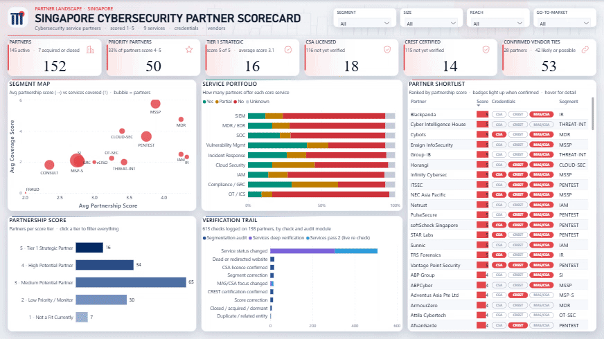

# Singapore Cybersecurity Partner Scorecard (Power BI)

A one-page Power BI dashboard of **152 Singapore cybersecurity services firms**, each scored 1-5 as a potential
channel partner and checked against 9 core services, 6 security vendors and 2 SIEM platforms. It continues the
[Cybersecurity Provider Screening Audit](https://github.com/ainunizhar/Cybersecurity-Provider-Screening-Audit), where
336 companies were screened and 153 kept.

## What's inside
- **Segment bubble map:** average score vs services covered for each segment; bubble size = partners.
- **Score tiers:** from Tier 1 Strategic Partner (score 5, 16 partners) down to Not a Fit Currently (score 1).
- **Service portfolio:** 100% status bars per service (Yes / Partial / No / Unknown).
- **Verification trail:** the 613-entry quality log from two verification passes and an audit that corrected 13
  scores and 16 segments.
- **Partner shortlist** with credential badges (CSA licence, CREST, MAS/CSA focus) drawn as SVG by DAX.
- KPI tiles with live subtitles and slicers in the header. Click any visual to cross-filter the page; hover a
  partner to see its profile card.

## How it's built
- Five research modules (segmentation, services, vendors, funding, go-to-market) joined on company name. Score and
  segment come only from the audited segmentation.
- Power Query unpivots the 9 service columns and the 5 module confidence columns. Mixed labels ("CONFIRMED (Elite
  partner; …)", "HIGH") are mapped to one set of statuses, and the original wording is kept.
- "None found" (searched, nothing found) is kept apart from "Unknown" (could not check). DAX `Coverage %` counts
  Partial as half and leaves unknowns out.
- The 1920×1080 background artboard and theme are generated in Python.

## Open it
- Open `powerbi/SingaporeCybersecurityPartnerScorecard.pbip` in Power BI Desktop, set the **DataFolder** parameter,
  and Refresh.
- The research data is private and not included. The model expects `sg_companies.csv`, `sg_vendor_status.csv` and
  `sg_quality_log.csv`.
- The decision-maker research is not included; only a count per partner is kept.

**Tools:** Power BI (PBIP: TMDL + PBIR), Power Query (M), DAX, SVG, Python · built with Claude Code as a coding
assistant
